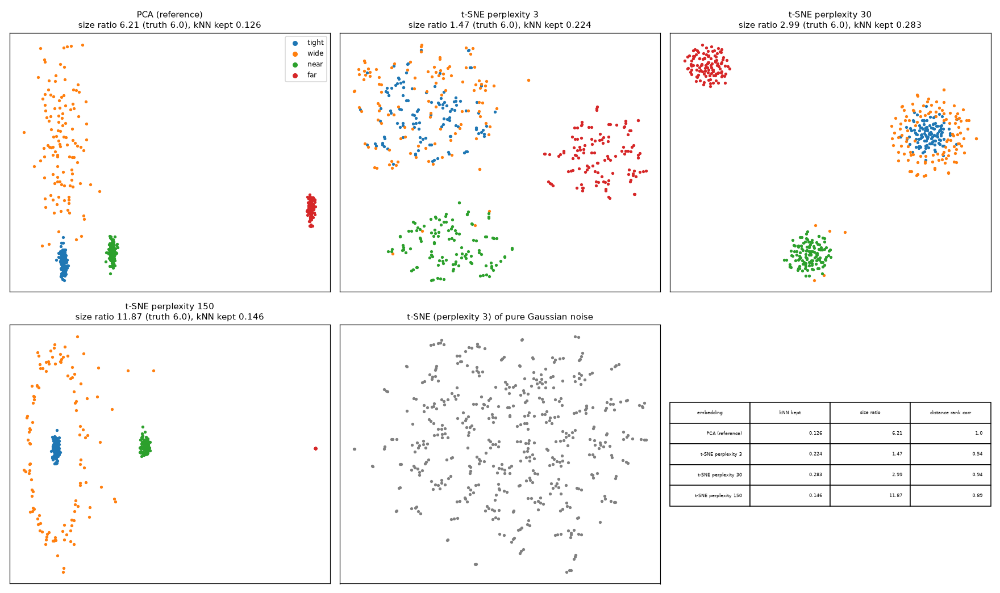

# t-SNE Perplexity Pitfalls

> Cluster sizes in a t-SNE plot mean nothing. Distances between clusters mean very little. And it will draw clusters in pure noise if you ask nicely.

## Demo Output



Produced from simulated data by `demo.py`: four clusters with known sizes and distances, embedded with PCA and t-SNE at three perplexities, plus t-SNE of pure noise.

## Why This Exists

t-SNE plots end up in figures, and figures end up as claims: "this population is more heterogeneous", "these two types are closely related". This repo puts numbers on what t-SNE actually keeps:

- **kNN preservation:** do local neighbourhoods survive? (Better than with PCA. Local structure is what t-SNE is built to keep.)
- **Size ratio:** does a cluster that is 6x wider look 6x wider? (No. Depending on perplexity, t-SNE can squash the difference to almost nothing or exaggerate it.)
- **Between-cluster distance rank correlation:** are far clusters drawn far apart? (It depends on perplexity and luck.)

## Reading a t-SNE Plot Honestly

| You see | You may conclude | You may NOT conclude |
|---------|------------------|----------------------|
| Separate islands | Points within an island are similar | Islands are equally distinct |
| One big, one small cluster | Nothing | One is more heterogeneous |
| Two islands close together | Possibly related | The distance is meaningful |
| Clumps at low perplexity | Nothing yet | They're real. Check against noise |

## Usage

```python
from embedding_checks import run_tsne, knn_preservation
Y = run_tsne(X, perplexity=30)
knn_preservation(X, Y)
```

## When NOT to Use This

- **Large datasets.** For 100k+ cells, use openTSNE or UMAP. sklearn's t-SNE is slow.
- **Quantitative claims.** Measure in the original space (or PCA space), never on the 2-D picture.
- **UMAP users.** It has the same caveats about sizes and distances, with different defaults.

## The Uncomfortable Truth

If a result only shows up in the t-SNE plot and not in the high-dimensional data, it isn't a result. It's a parameter setting.

## Further Reading

- van der Maaten L. & Hinton G. "Visualizing Data using t-SNE." Journal of Machine Learning Research (2008).
- Wattenberg M., Viégas F. & Johnson I. "How to Use t-SNE Effectively." Distill (2016).
- Kobak D. & Berens P. "The art of using t-SNE for single-cell transcriptomics." Nature Communications (2019).
